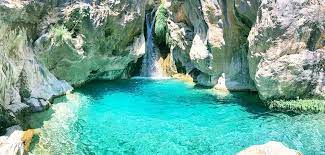
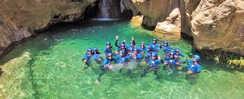

Hey there, fellow adventurer!

Let me tell you about this amazing spot just a short drive away from Villa Los Olivos. It’s called La Junta de los Ríos, and trust me, it’s like stepping into a real-life jungle gym! Picture this: waterfalls cascading into crystal-clear pools, rugged rocks to climb, and all the thrills you can imagine. It’s the ultimate playground for anyone craving a bit of excitement and nature’s beauty.

So, imagine driving through winding roads, surrounded by lush greenery, until suddenly, you stumble upon this magical place. Two rivers meet here, carving out a wonderland of waterfalls and hidden pools. It’s like something out of a fairy tale!

Now, let’s talk about the fun part: canyoning! It’s all about exploring these natural wonders in the coolest way possible. You’ll be rappelling down waterfalls, sliding through natural rock formations, and splashing into refreshing pools. It’s like being a kid again, only way more epic!

Don’t worry if you’re new to canyoning – there are guided tours for every level. Friendly instructors will show you the ropes (literally!) and make sure you have a blast while staying safe. Whether you’re a total beginner or a seasoned pro, there’s something here for you.

But it’s not just about the adrenaline rush – it’s also about soaking in the beauty of nature. Surrounded by lush forests and the soothing sounds of waterfalls, you’ll feel like you’re in paradise. It’s the perfect way to recharge and reconnect with the world around you.

So, what are you waiting for? Grab your gear, round up your friends, and head over to La Junta de los Ríos for an unforgettable day of adventure. And when you’re done, head back to Villa Los Olivos to relax and share stories about your epic day. Trust me, it’s going to be one for the books!

Get ready to dive into adventure at La Junta de los Ríos! With its close proximity to Villa Los Olivos, it’s the perfect addition to your Costa Tropical getaway. So, pack your sense of adventure and get ready for the time of your life!

Price-wise, to get access to the Waterfalls, it will cost 5€ per person and 5€ per car.

Opening hours are everyday from 10am to 7pm during summer times.

Here is a Google Map link that will get you there from Villa Los Olivos to La Junta de los Rios: [https://maps.app.goo.gl/bWXavcdebL4HAvug9](https://maps.app.goo.gl/bWXavcdebL4HAvug9)

And if you don’t trust us, here are a few other links talking about it:

-   [https://www.tripadvisor.com/Attraction\_Review-g1069220-d4661477-Reviews-Junta\_de\_los\_Rios-Otivar\_Province\_of\_Granada\_Andalucia.html](https://www.tripadvisor.com/Attraction_Review-g1069220-d4661477-Reviews-Junta_de_los_Rios-Otivar_Province_of_Granada_Andalucia.html)
-   [https://www.costatropical.net/almunecar/junta-de-los-rios.php](https://www.costatropical.net/almunecar/junta-de-los-rios.php)
-   [https://www.spain-holiday.com/Otivar/articles/junta-de-los-rios-otivar-granada](https://www.spain-holiday.com/Otivar/articles/junta-de-los-rios-otivar-granada)
