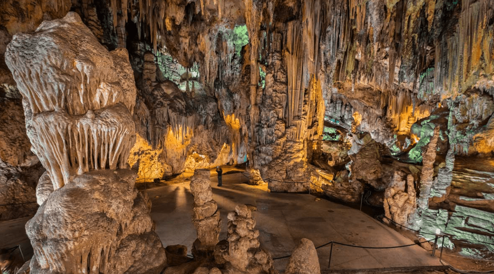

Nestled along the Costa del Sol, just a short drive from Villa Los Olivos (less than 30 minutes away), lies the enchanting town of Nerja. Famous for its crystal-clear waters, stunning viewpoints, and rich cultural heritage, Nerja offers a perfect blend of relaxation and adventure. Whether you’re seeking a tranquil escape or an action-packed day, Nerja has something to captivate every traveler. Let’s explore what makes this coastal gem a must-visit destination during your stay at Villa Los Olivos.

### Morning: Exploring the Natural Wonders

#### The Nerja Caves (Cueva de Nerja)

Start your day with a visit to the Nerja Caves, one of Spain’s most spectacular natural attractions. Discovered in 1959, these vast caverns are home to awe-inspiring stalactites and stalagmites, as well as the world’s largest column, the towering Cataclysm. The caves also host concerts in their natural amphitheater, providing a unique acoustic experience. Guided tours are available, offering fascinating insights into the geological formations and prehistoric cave paintings.

Official website here: [https://cuevadenerja.es/](https://cuevadenerja.es/)

#### Balcony of Europe (Balcón de Europa)

After exploring the caves, head to the Balcony of Europe, a breathtaking viewpoint located in the heart of Nerja. Perched high on a cliff, this spot offers panoramic views of the Mediterranean Sea and the rugged coastline. It’s the perfect place to take some stunning photographs and enjoy a leisurely stroll. The area around the Balcony of Europe is dotted with charming cafes and shops, where you can enjoy a coffee and soak in the vibrant atmosphere.

### Afternoon: Beaches and Culinary Delights

#### Playa Burriana

No visit to Nerja is complete without spending time at one of its beautiful beaches. Playa Burriana, the town’s most popular beach, boasts golden sands and calm, turquoise waters. It’s an ideal spot for swimming, sunbathing, or participating in water sports like paddleboarding and kayaking. Numerous beachfront restaurants, known as chiringuitos, line the shore, offering fresh seafood and traditional Spanish dishes.

#### Lunch at Ayo’s

For an authentic culinary experience, head to Ayo’s, a famous chiringuito on Playa Burriana. This iconic eatery is renowned for its paella, cooked over an open fire in massive pans. The family-run restaurant has been serving locals and visitors since 1969, making it a beloved institution in Nerja. Enjoy your meal with a glass of sangria and the sound of waves lapping the shore.

Official website: [https://ayonerja.com/](https://ayonerja.com/)

### Evening: Culture and Leisure

#### Historic Old Town

In the evening, explore Nerja’s historic old town. Wander through narrow, winding streets adorned with whitewashed houses and vibrant flower pots. The old town is home to several historical landmarks, including the 17th-century Church of El Salvador, which showcases beautiful baroque and Moorish architecture. The quaint shops and boutiques offer unique souvenirs, from handcrafted ceramics to local wines.

#### Tapas and Nightlife

As the sun sets, immerse yourself in Nerja’s lively tapas scene. Hop from bar to bar, sampling a variety of tapas dishes such as boquerones (anchovies), albondigas (meatballs), and tortilla española (Spanish omelette). Popular spots include La Piqueta and El Pulguilla, both known for their delicious small plates and convivial atmosphere.

For those looking to extend their evening, Nerja offers a vibrant nightlife. Enjoy live music at bars like Cochran’s Terrace or dance the night away at one of the local clubs. The town’s friendly and welcoming vibe ensures a memorable night out.

### Tips for a Perfect Day Trip

-   **Transport:** Nerja is about a 30-minute drive from Villa Los Olivos.
-   **Timing:** To make the most of your day, start early. The Nerja Caves open at 10 AM, and mornings are generally less crowded.
-   **Comfort:** Wear comfortable shoes for exploring, and don’t forget your beach gear if you plan to enjoy the sand and sea.
-   **Reservations:** Popular restaurants like Ayo’s can get busy, especially during peak season, so consider making a reservation in advance.

### Conclusion

A day trip to Nerja is a journey through natural beauty, rich history, and delectable cuisine. From the mystical caves and panoramic viewpoints to the golden beaches and vibrant tapas bars, Nerja offers an unforgettable experience for every visitor. Make the most of your stay at Villa Los Olivos by discovering the many charms of this stunning coastal town. ¡Feliz viaje!

More info:

-   [https://www.tripadvisor.com/Tourism-g315917-Nerja\_Costa\_del\_Sol\_Province\_of\_Malaga\_Andalucia-Vacations.html](https://www.tripadvisor.com/Tourism-g315917-Nerja_Costa_del_Sol_Province_of_Malaga_Andalucia-Vacations.html)
