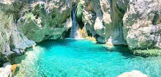
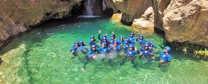

¡Hola, aventurero!

Te queremos hablar de un lugar increíble a poca distancia en coche de Villa Los Olivos. Se llama la Junta de los Ríos y, créenos, es como un parque de aventuras natural. Imagínatelo: cascadas que caen en pozas de agua cristalina, rocas para trepar y toda la emoción que puedas imaginar. Es el sitio perfecto para quien busca un poco de adrenalina y la belleza de la naturaleza.

Imagina que conduces por carreteras de curvas, rodeado de vegetación, hasta que de repente llegas a este lugar mágico. Aquí se unen dos ríos y han ido formando un mundo de cascadas y pozas escondidas. ¡Parece sacado de un cuento!

Ahora, la parte divertida: ¡el barranquismo! Se trata de recorrer estas maravillas naturales de la forma más emocionante posible: haciendo rápel por las cascadas, deslizándote por toboganes de roca natural y saltando a pozas refrescantes. Es como volver a ser un niño, pero todavía mejor.

No te preocupes si nunca has hecho barranquismo: hay rutas guiadas para todos los niveles. Los monitores te enseñarán todo lo necesario y se asegurarán de que lo pases en grande y con total seguridad. Seas principiante o experto, aquí hay algo para ti.

Pero no todo es adrenalina: también se trata de disfrutar de la naturaleza. Rodeado de bosque y con el sonido relajante de las cascadas, te sentirás en el paraíso. Es la forma perfecta de recargar energía y desconectar.

¿A qué esperas? Coge tu equipo, reúne a tus amigos y vete a la Junta de los Ríos para pasar un día de aventura inolvidable. Y cuando termines, vuelve a Villa Los Olivos para descansar y contar las anécdotas del día.

Al estar tan cerca de Villa Los Olivos, la Junta de los Ríos es el complemento perfecto para tu escapada a la Costa Tropical.

En cuanto al precio, el acceso a las cascadas cuesta 5 € por persona y 5 € por coche.

En verano abre todos los días de 10:00 a 19:00.

Aquí tienes el enlace de Google Maps para llegar desde Villa Los Olivos a la Junta de los Ríos: [https://maps.app.goo.gl/bWXavcdebL4HAvug9](https://maps.app.goo.gl/bWXavcdebL4HAvug9)

Y si no nos crees, aquí tienes otros sitios que hablan de ella:

-   [https://www.tripadvisor.es/Attraction_Review-g1069220-d4661477-Reviews-Junta_de_los_Rios-Otivar_Province_of_Granada_Andalucia.html](https://www.tripadvisor.es/Attraction_Review-g1069220-d4661477-Reviews-Junta_de_los_Rios-Otivar_Province_of_Granada_Andalucia.html)
-   [https://www.costatropical.net/almunecar/junta-de-los-rios.php](https://www.costatropical.net/almunecar/junta-de-los-rios.php)
