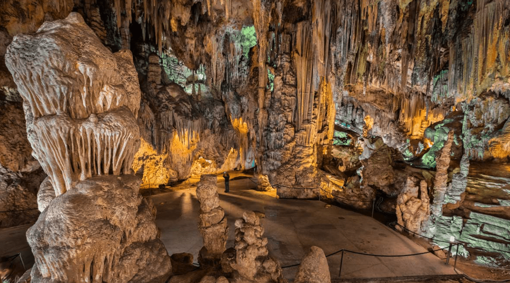
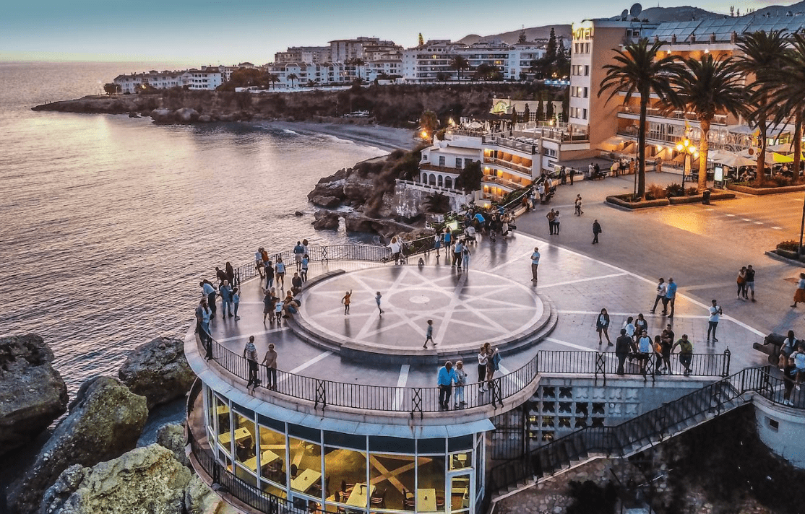

En la Costa del Sol, a menos de 30 minutos en coche de Villa Los Olivos, se encuentra el encantador pueblo de Nerja. Famoso por sus aguas cristalinas, sus miradores y su riqueza cultural, Nerja combina a la perfección descanso y aventura. Tanto si buscas una escapada tranquila como un día lleno de actividad, Nerja tiene algo para cada viajero. Te contamos por qué esta joya de la costa es una visita obligada durante tu estancia en Villa Los Olivos.

### Por la mañana: maravillas naturales

#### La Cueva de Nerja

Empieza el día visitando la Cueva de Nerja, uno de los atractivos naturales más espectaculares de España. Descubierta en 1959, sus enormes galerías albergan estalactitas y estalagmitas impresionantes, además de la columna más grande del mundo, el gran Cataclismo. La cueva acoge también conciertos en su anfiteatro natural, con una acústica única. Hay visitas guiadas que explican las formaciones geológicas y las pinturas rupestres prehistóricas.

Web oficial: [https://cuevadenerja.es/](https://cuevadenerja.es/)

#### El Balcón de Europa

Después de la cueva, dirígete al Balcón de Europa, un mirador impresionante en pleno centro de Nerja. Asomado a un acantilado, ofrece vistas panorámicas del Mediterráneo y de la costa abrupta. Es el lugar perfecto para hacer fotos y dar un paseo tranquilo. Alrededor hay cafeterías y tiendas con mucho encanto donde tomar un café y disfrutar del ambiente.

### Por la tarde: playa y buena mesa

#### Playa de Burriana

Ninguna visita a Nerja está completa sin pasar un rato en una de sus playas. Burriana, la más popular, tiene arena dorada y aguas tranquilas de color turquesa. Es ideal para bañarse, tomar el sol o practicar deportes acuáticos como paddle surf o kayak. A lo largo de la orilla hay muchos chiringuitos con pescado fresco y cocina tradicional.

#### Comer en Ayo

Para una experiencia gastronómica auténtica, ve a Ayo, un chiringuito famoso de la playa de Burriana. Este local emblemático es conocido por su paella, cocinada a la leña en paelleras gigantes. Este restaurante familiar lleva sirviendo a vecinos y visitantes desde 1969 y es toda una institución en Nerja. Acompaña la comida con una sangría y el sonido de las olas.

Web oficial: [https://ayonerja.com/](https://ayonerja.com/)

### Por la noche: cultura y ocio

#### El casco antiguo

Al caer la tarde, recorre el casco antiguo de Nerja. Pasea por sus callejuelas de casas encaladas y macetas llenas de flores. Aquí se encuentran varios monumentos, como la iglesia de El Salvador, del siglo XVII, con una bonita mezcla de barroco y mudéjar. Las tiendas del centro ofrecen recuerdos únicos, desde cerámica artesanal hasta vinos de la zona.

#### Tapas y vida nocturna

Cuando se pone el sol, déjate llevar por el ambiente de tapeo de Nerja. Ve de bar en bar probando boquerones, albóndigas o tortilla española. La Piqueta y El Pulguilla son dos sitios muy populares, conocidos por sus tapas y su buen ambiente.

Si quieres alargar la noche, Nerja tiene una vida nocturna animada: música en directo en bares como Cochran's Terrace o baile en alguno de sus locales. El ambiente cercano y acogedor del pueblo garantiza una noche memorable.

### Consejos para un día perfecto

-   **Transporte:** Nerja está a unos 30 minutos en coche de Villa Los Olivos.
-   **Horario:** para aprovechar el día, sal temprano. La Cueva de Nerja abre a las 10:00 y por la mañana suele haber menos gente.
-   **Comodidad:** lleva calzado cómodo para caminar y no olvides las cosas de playa si quieres disfrutar del mar.
-   **Reservas:** los restaurantes populares como Ayo se llenan, sobre todo en temporada alta, así que conviene reservar.

### En resumen

Una excursión a Nerja es un viaje por la naturaleza, la historia y la buena cocina. De la cueva y sus miradores a las playas doradas y los bares de tapas, Nerja ofrece una experiencia inolvidable. Aprovecha tu estancia en Villa Los Olivos para descubrir todos los encantos de este precioso pueblo costero. ¡Buen viaje!

Más información:

-   [https://www.tripadvisor.es/Tourism-g315917-Nerja_Costa_del_Sol_Province_of_Malaga_Andalucia-Vacations.html](https://www.tripadvisor.es/Tourism-g315917-Nerja_Costa_del_Sol_Province_of_Malaga_Andalucia-Vacations.html)
