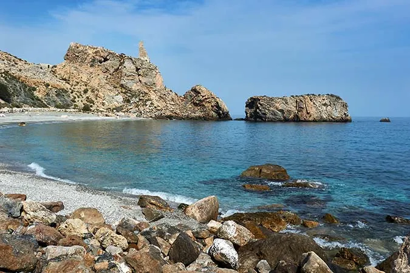
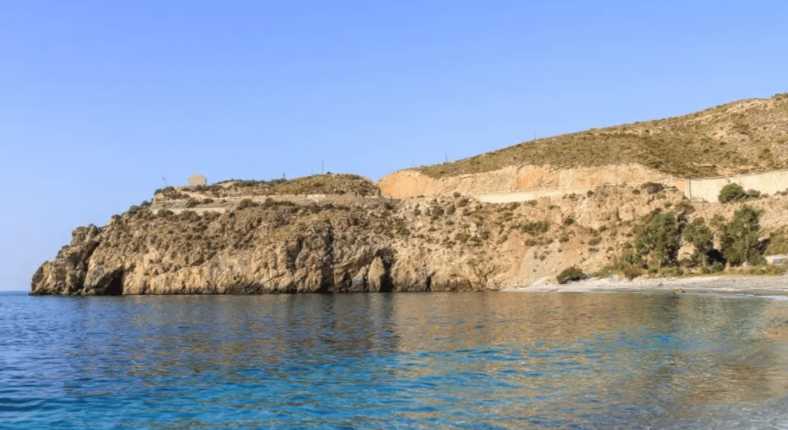

¡Hola, amante de la playa!

¿Alguna vez has soñado con encontrar un rincón del paraíso donde la arena y el mar se unen en perfecta armonía? Pues te presentamos la playa de La Rijana, una de nuestras joyas escondidas favoritas de la Costa Tropical, ¡esperando a que la descubras!

La Rijana no es una playa cualquiera: es una obra de arte. De los acantilados que enmarcan la costa a las aguas cristalinas que invitan a darse un baño, cada rincón es pura magia. Tanto si te gusta tumbarte al sol como si eres amante de la naturaleza, su belleza intacta te dejará sin palabras.

Pero La Rijana no es solo para descansar en la arena (¡aunque eso también está genial!). Si te apetece algo de aventura, coge unas gafas de snorkel y descubre su mundo submarino, o ponte las botas y recorre los senderos que bordean los acantilados. ¡No te vas a aburrir!

¿Lo mejor? La Rijana está muy cerca de Villa Los Olivos, así que llegar es facilísimo. Súbete al coche, baja las ventanillas y, durante los 20 minutos de trayecto, deja que la brisa del mar te acompañe por la carretera de la costa. Antes de que te des cuenta estarás aparcando, listo para un día de sol, mar y tranquilidad.

Coge la crema solar y tu libro favorito, y prepárate para vivir recuerdos inolvidables en este paraíso escondido. Una vez que conozcas la magia de La Rijana, te preguntarás por qué perdías el tiempo en playas abarrotadas. ¿Listo para descubrir la verdadera joya de la Costa Tropical?

Está junto a la carretera N-340, donde hay un pequeño aparcamiento. Se accede a pie por un camino con algo de pendiente. En verano tiene un pequeño chiringuito. Es una playa de arena y grava.

Aquí tienes el enlace de Google Maps para llegar desde Villa Los Olivos a la playa de La Rijana: [https://maps.app.goo.gl/zYhr3Y8yVyb2eW7G6](https://maps.app.goo.gl/zYhr3Y8yVyb2eW7G6)

Y otros sitios que también hablan de La Rijana:

-   [https://www.tripadvisor.es/Attraction_Review-g1567913-d10406610-Reviews-Playa_Rijana-Castell_de_Ferro_Province_of_Granada_Andalucia.html](https://www.tripadvisor.es/Attraction_Review-g1567913-d10406610-Reviews-Playa_Rijana-Castell_de_Ferro_Province_of_Granada_Andalucia.html)
