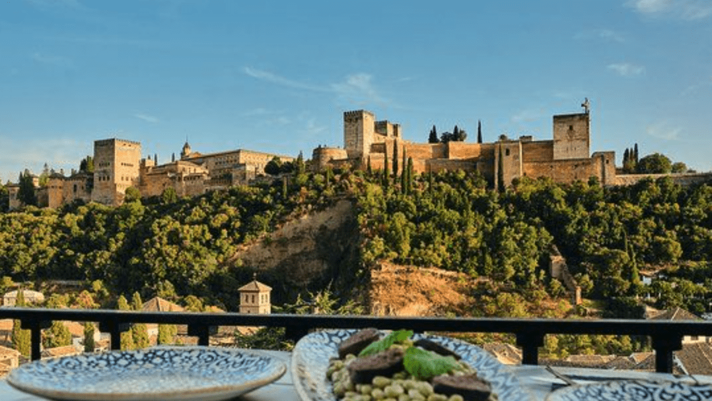

¡Hola a todos!

Hoy nos embarcamos en una aventura a medida por la encantadora ciudad de Granada, donde cada momento promete estar lleno de magia. Así que ponte un calzado cómodo y vamos a pasar un día descubriendo la ciudad, empezando aquí mismo, en tu casa lejos de casa.

A menos de una hora en coche de Villa Los Olivos.

Mientras el sol de la mañana ilumina los tejados de terracota de Villa Los Olivos, empezamos el día con un desayuno tranquilo y un tradicional pan con tomate. Rodeados de cítricos y buganvillas, este oasis de calma es el escenario perfecto para las aventuras que nos esperan. Disfruta de un zumo de naranja recién exprimido y de la repostería andaluza mientras planeamos la ruta por Granada.

¿Nuestro primer destino? La legendaria Alhambra, a un paseo del centro de la ciudad. A medida que recorremos las estrechas calles del Albaicín, el antiguo barrio morisco, la emoción va en aumento. Al llegar a las puertas de la Alhambra, nos recibe esta obra maestra de la arquitectura, que se alza majestuosa con Sierra Nevada al fondo.

Al recorrer las salas de los Palacios Nazaríes, merece la pena detenerse a admirar las yeserías, los alicatados geométricos y los delicados arabescos que cubren cada superficie. De la serenidad del Patio de los Leones a las vistas impresionantes de los jardines del Generalife, cada rincón de la Alhambra cuenta la historia de imperios pasados y de un legado que perdura.

Después de una mañana de visitas, toca reponer fuerzas con una buena comida en un bar de tapas, a dos pasos de la Alhambra. Aquí disfrutaremos de un festín de sabores andaluces: jamón ibérico recién cortado, gambas al ajillo chisporroteando y unas cremosas croquetas de jamón. Con cada bocado saborearemos la herencia gastronómica de Granada, sabiendo que cada plato se prepara con cariño y tradición.

Bien comidos y con energía renovada, volvemos a Villa Los Olivos para pasar una tarde de descanso. Tanto si prefieres relajarte junto a la piscina, echarte una siesta a la sombra de los olivos o simplemente disfrutar del paisaje, el ambiente tranquilo de la villa te ayudará a recargar las pilas.

Cuando el sol empieza a ponerse sobre el campo andaluz, nos reunimos para una cena de despedida bajo las estrellas, preparada especialmente para ti por nuestro chef. Con un menú inspirado en los sabores de Granada, cada plato es una celebración de los productos locales. Levanta una copa de Albariño bien fresco y brindemos por los recuerdos y las amistades de este día en una ciudad mágica.

Y así, queridos huéspedes, termina nuestro día en Granada. Ojalá os llevéis el espíritu de esta ciudad encantadora allá donde vayáis. De la belleza eterna de la Alhambra a la calidez de Villa Los Olivos, Granada es un destino que deja huella.

Estos son algunos de nuestros platos tradicionales favoritos:

## Platos típicos de Granada

-   **Habas con jamón**: probablemente uno de los platos más tradicionales de Granada. Se sirven en cazuela con un sofrito en casi todos los restaurantes de la ciudad.
-   **Tortilla del [Sacromonte](https://www.granada.info/sacromonte)**: esta tortilla, típica de Granada y del barrio que le da nombre, se prepara con sesos de cordero, chorizo, nueces y pan rallado. Es exclusiva de la cocina granadina, así que no te vayas sin probarla.
-   **Remojón granadino**: la influencia árabe de Granada se refleja a la perfección en este plato de naranja, bacalao, aceitunas, huevo cocido, cebolla y tomate.
-   **Zalamandroña**: una ensalada fría ideal para combatir el calor si visitas Granada en verano. Lleva pimiento asado, calabacín, bacalao, tomate seco, aceitunas y aceite de oliva.
-   **Berenjenas con miel**: también típicas de la cocina cordobesa, son rodajas de berenjena fritas en aceite de oliva con miel de caña.
-   **Pionono**: el dulce granadino por excelencia. Se elabora en Santa Fe, un pueblo de Granada, y es un bizcocho cubierto de crema.
-   **Soplillos alpujarreños**: aunque son típicos de la [Alpujarra](https://www.granada.info/alpujarra), los encontrarás por toda Granada. De origen árabe, se hacen con huevo, azúcar, almendra y limón.

Escríbenos si quieres recomendaciones de restaurantes 🙂

Algunos enlaces útiles si estás planificando una excursión a Granada:

-   Reserva tus entradas con mucha antelación (si puedes, con unos meses) en la web oficial: [https://alhambra-entradas.org/](https://alhambra-entradas.org/)
-   Visitas guiadas a pie por Granada: [https://www.viator.com/es-ES/Granada/d554](https://www.viator.com/es-ES/Granada/d554)
-   Qué hacer en Granada: [https://www.tripadvisor.es/Tourism-g187441-Granada_Province_of_Granada_Andalucia-Vacations.html](https://www.tripadvisor.es/Tourism-g187441-Granada_Province_of_Granada_Andalucia-Vacations.html)
