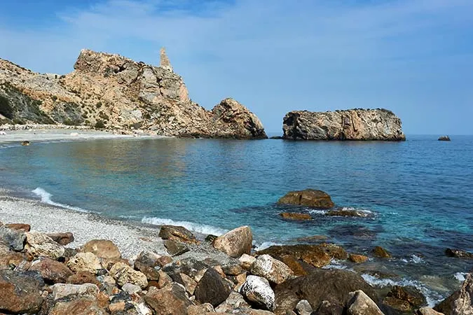
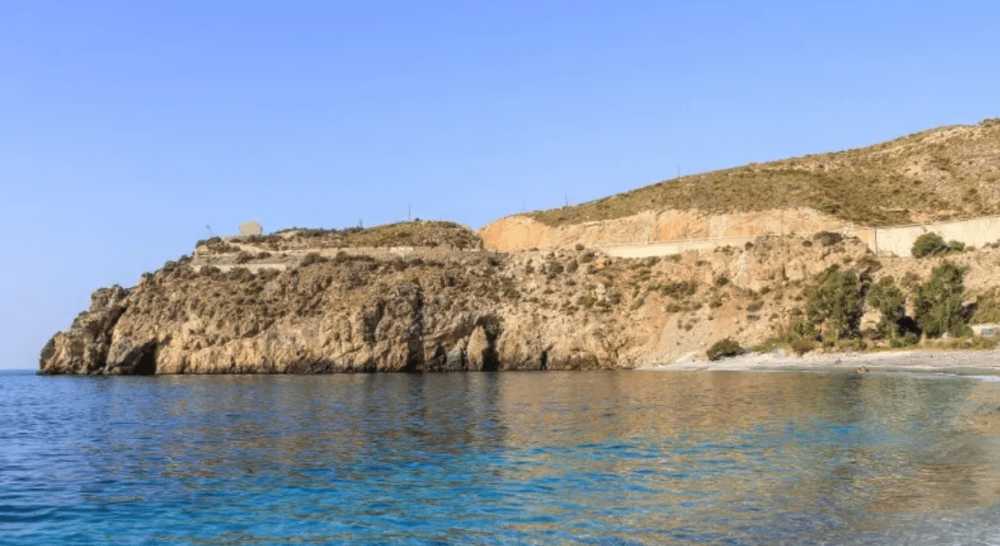

Hey there fellow beach enthusiast!

Have you ever dreamt of stumbling upon a slice of paradise where the sun-kissed sands meet the azure waves in perfect harmony? Well, let me introduce you to La Rijana Beach – one of our favorite hidden gems of Costa Tropical that’s just waiting to be explored!

La Rijana isn’t just your average beach – it’s a masterpiece. From the rugged cliffs that frame the coastline to the crystal-clear waters that beckon you for a dip, every inch of this place is pure magic. Whether you’re a beach bum or a nature lover, you’ll find yourself mesmerized by the untouched beauty that surrounds you.

But hey, La Rijana isn’t all about lazing around on the sand (although that’s pretty great too!). If you’re feeling adventurous, why not grab a snorkel and dive into the underwater wonderland? Or lace up your hiking boots and explore the coastal trails that wind their way along the cliffs? Trust me, there’s no shortage of excitement here!

The best part? La Rijana is just a stone’s throw away from Villa Los Olivos, so getting there is a breeze! Hop in your car, roll down the windows, and during the 20 minutes drive between Villa Los Olivos and the beach let the salty sea breeze guide you along the scenic coastal roads. Before you know it, you’ll be parking up and ready to embark on your day of sun, sea, and serenity.

Pack your sunscreen, grab your favorite beach read, and get ready to make some unforgettable memories in this hidden paradise. Trust me, once you experience the magic of La Rijana, you’ll wonder why you ever wasted your time at those overcrowded tourist traps. It’s time to discover the real jewel of the Costa Tropical – are you ready?

It is located next to the N-340 road, where there is a small parking lot. Access must be done on foot through a slightly steep terrain. It has a small beach bar open during summer times. It is made up of sand and gravel.

Here is a Google Maps link that gets you from Villa Los Olivos to La Rijana beach: [https://maps.app.goo.gl/zYhr3Y8yVyb2eW7G6](https://maps.app.goo.gl/zYhr3Y8yVyb2eW7G6)

And checkout other websites also speaking about La Rijana:

-   [https://www.tripadvisor.com/Attraction\_Review-g1567913-d10406610-Reviews-Playa\_Rijana-Castell\_de\_Ferro\_Province\_of\_Granada\_Andalucia.html](https://www.tripadvisor.com/Attraction_Review-g1567913-d10406610-Reviews-Playa_Rijana-Castell_de_Ferro_Province_of_Granada_Andalucia.html)
-   [https://curioustravelbug.com/spain-costa-tropical-la-rijana-beach/](https://curioustravelbug.com/spain-costa-tropical-la-rijana-beach/)
